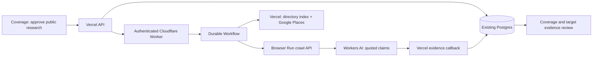

# Event-driven public website research

The Vercel application remains the UI, authentication layer and only database writer. A Cloudflare Worker starts a named Workflow for each saved job. The Workflow calls back to Vercel for the approved public search configuration, submits bounded Browser Run crawls, waits durably, extracts claims with Workers AI, and returns evidence to the app. There is no always-on Python/Fly.io server or queue to operate.

## Scope and boundaries

- The Workflow payload contains only a job UUID. Private buyer financial criteria stay in Vercel. Google receives only user-approved search terms/geography; Cloudflare receives the approved research configuration and public pages. No outreach is sent.
- Discovery uses the existing directory index plus Google Places, then follows relevant links actually observed in fetched pages. This is bounded research, not exhaustive search or autonomous general web search. Crawl4AI is not installed in production.
- User limits: up to five one-page crawl submissions, five domains, fifteen minutes and five model calls. UI defaults to three pages/domains/model calls and ten minutes. Account quotas are shared; these job limits do not guarantee free operation.
- One active job per organisation. Named Workflow instances make dispatch repeatable. Ambiguous crawl submissions and AI calls are not automatically retried, avoiding duplicate billed submissions. Callback writes deduplicate evidence and use monotonic progress revisions. Discovery is claimed once; interrupted discovery may retain only supplied/previously saved seeds.
- Deadlines are checked between external actions, not hard preemption of in-flight requests. Cancellation retains saved findings and requests provider cleanup. A provider outage can prevent cancellation acknowledgement. A stalled job can be cancelled from Coverage, freeing the organisation slot; queued jobs can be reconnected without creating a second Workflow.
- Pages are truncated to 24,000 characters for validation; the model receives at most 12,000 characters and 1,200 output tokens. Full crawls are not archived. Only extracted quoted findings persist in the application database. Linked pages may be explored without successful extraction.
- Claims require verbatim quote/value matching. Company names must occur in their quote, and websites must occur in observed links or match the source origin. Accreditation mentions remain unverified and never automatically update certified status or scoring. Confidence 0.5 is a fixed provisional label, not a calibrated probability.
- URL validation allows public HTTPS hostnames, rejects literal IPs/local names/credentials, and strips query strings. Browser Run enforces destination access; the app does not fetch user-supplied URLs directly. Query-dependent pages are intentionally unsupported.

## Activation

1. Review `drizzle/0004_research_jobs.sql`. **Receive explicit approval for this specific migration and database before applying it.** It adds two tables, foreign keys, lookup indexes and one-active-job/evidence uniqueness indexes; it does not change existing business records.
2. Configure Worker secrets: `SERVICE_SECRET` (random shared secret), `CF_ACCOUNT_ID`, `CF_BROWSER_TOKEN` (Browser Rendering permission). Configure `APP_ORIGIN` to the application's HTTPS origin. Keep secrets out of Git.
3. Deploy with `pnpm exec wrangler deploy --config cloudflare/research/wrangler.jsonc` using an account token with Workers Scripts, Workflows and Workers AI permissions, and a registered workers.dev subdomain or custom route.
4. Configure Vercel `RESEARCH_WORKER_URL` and matching `RESEARCH_SERVICE_SECRET`. After the approved migration succeeds, set `RESEARCH_ENABLED=true` and redeploy. Until then the API returns disabled without querying the new tables.
5. Smoke-test with one approved public URL, discovery disabled and one page. Confirm job completion, cited evidence, repeated dispatch identity and cancellation. Do not use confidential buyer examples.

To disable new work, set `RESEARCH_ENABLED=false` and redeploy. Cancel active jobs first so their callbacks remain available for cleanup. Never remove the new tables as a casual rollback; saved evidence should be retained.

## Validation

`pnpm test`, `pnpm lint`, `pnpm typecheck`, `pnpm build`, `pnpm exec tsc -p cloudflare/research/tsconfig.json`, and `pnpm exec wrangler deploy --dry-run --config cloudflare/research/wrangler.jsonc`.

Tests use fictional domains and mocked providers; they do not consume crawl or AI quota. Runtime integration against the new database requires the migration approval above.

## Research sources (checked 8 September 2026)

- [Workflow API and named instances](https://developers.cloudflare.com/workflows/build/workers-api/)
- [Durable sleeping and retries](https://developers.cloudflare.com/workflows/build/sleeping-and-retrying/)
- [Browser Run crawl endpoint](https://developers.cloudflare.com/browser-run/quick-actions/crawl-endpoint/)
- [Browser Run pricing and shared quotas](https://developers.cloudflare.com/browser-run/pricing/)
- [Workers AI pricing](https://developers.cloudflare.com/workers-ai/platform/pricing/)

The earlier local benchmark is retained in ignored `.local-data/crawler-benchmark/REPORT.md`. It compared public directory/static/JavaScript fixtures; it does not establish production throughput or full market coverage.
