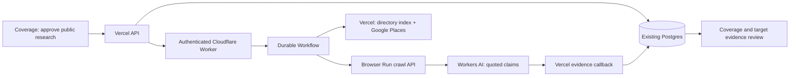

# Event-driven public website research

The Vercel application remains the UI, authentication layer and only database writer. A Cloudflare Worker starts a named Workflow for each saved job. The Workflow calls back to Vercel for the approved public search configuration, submits bounded Browser Run crawls, waits durably, extracts claims with Workers AI, and returns evidence to the app. There is no always-on Python/Fly.io server or queue to operate.

## Scope and boundaries

- The Workflow payload contains only a job UUID. Private buyer financial criteria stay in Vercel. Google receives only user-approved search terms/geography; Cloudflare receives the approved research configuration and public pages. No outreach is sent.
- Discovery splits approved descriptions into up to nine focused supplier queries, interleaves the results, and uses the existing directory index plus Google Places. The crawler visits unseen domains before following relevant product, wholesale and capability links. Consumer advice and blog links are deprioritized by exclusion. This is bounded research, not exhaustive search or autonomous general web search. Crawl4AI is not installed in production.
- Pending URLs, visited URLs, per-page outcomes and exact provider status/HTTP codes (where reported) are checkpointed in the existing job configuration JSON. No further database migration is needed. Continue research creates a new job with a fresh approved budget, reuses server-owned terms and remaining URLs, and skips completed pages. Legacy jobs can recover starting URLs minus pages with saved evidence, but cannot reconstruct their full missing page history.
- User limits: up to five one-page crawl submissions, five domains, fifteen minutes and five model calls. UI defaults to three pages/domains/model calls and ten minutes. Account quotas are shared; these job limits do not guarantee free operation.
- One active job per organisation. Named Workflow instances make dispatch repeatable. Ambiguous crawl submissions and AI calls are not automatically retried, avoiding duplicate billed submissions. Callback writes deduplicate evidence and use monotonic progress revisions. Discovery is claimed once; interrupted discovery may retain only supplied/previously saved seeds.
- Deadlines are checked between external actions, not hard preemption of in-flight requests. Cancellation retains saved findings and requests provider cleanup. A provider outage can prevent cancellation acknowledgement. A stalled job can be cancelled from Coverage, freeing the organisation slot; queued jobs can be reconnected without creating a second Workflow.
- Pages are truncated to 24,000 characters for validation; the model receives at most 12,000 characters and 1,200 output tokens. Full crawls are not archived. Quoted findings and page progress persist in the application database. Linked pages may be explored without successful extraction.
- Extraction uses `@cf/meta/llama-3.1-8b-instruct-fast` in JSON mode; both object and text responses are supported. Malformed findings are discarded individually and results are capped at twelve.
- Claims require verbatim quote/value matching and meaningful business assertions. Business roles require a literal role/activity; selling or partnering does not establish manufacturing. ABNs/ACNs are identifiers, never accreditations. Generic guidelines and information about third parties are omitted from the review. Company names must occur in their quote, and websites must occur in observed links or match the source origin. Accreditation mentions remain unverified and never automatically update certified status or scoring. The legacy numeric confidence field is not displayed: the UI uses quoted-statement, unverified-certification and unverified-identifier labels. Findings are grouped by website/company and duplicate claim values share their source references. Product relevance is provisional and does not establish financial fit.
- URL validation allows public HTTPS hostnames, rejects literal IPs/local names/credentials, and strips query strings. Browser Run enforces destination access; the app does not fetch user-supplied URLs directly. Query-dependent pages are intentionally unsupported.

## Activation

1. Review `drizzle/0004_research_jobs.sql`. **Receive explicit approval for this specific migration and database before applying it.** It adds two tables, foreign keys, lookup indexes and one-active-job/evidence uniqueness indexes; it does not change existing business records.
2. Configure Worker secrets: `SERVICE_SECRET` (random shared secret), `CF_ACCOUNT_ID`, `CF_BROWSER_TOKEN` (Browser Rendering permission). Configure `APP_ORIGIN` to the application's HTTPS origin. Keep secrets out of Git.
3. Deploy with `pnpm exec wrangler deploy --config cloudflare/research/wrangler.jsonc` using an account token with Workers Scripts, Workflows and Workers AI permissions, and a registered workers.dev subdomain or custom route.
4. Configure Vercel `RESEARCH_WORKER_URL` and matching `RESEARCH_SERVICE_SECRET`. After the approved migration succeeds, set `RESEARCH_ENABLED=true` and redeploy. Until then the API returns disabled without querying the new tables.
5. Smoke-test with one approved public URL, discovery disabled and one page. Confirm job completion, cited evidence, repeated dispatch identity and cancellation. Do not use confidential buyer examples.

To disable new work, set `RESEARCH_ENABLED=false` and redeploy. Cancel active jobs first so their callbacks remain available for cleanup. Never remove the new tables as a casual rollback; saved evidence should be retained.

## Validation

`pnpm test`, `pnpm lint`, `pnpm typecheck`, `pnpm build`, `pnpm exec tsc -p cloudflare/research/tsconfig.json`, and `pnpm exec wrangler deploy --dry-run --config cloudflare/research/wrangler.jsonc`.

Tests use fictional domains and mocked providers; they do not consume crawl or AI quota. Runtime integration against the new database requires the migration approval above.

## Research sources (checked 8 September 2026)

- [Workflow API and named instances](https://developers.cloudflare.com/workflows/build/workers-api/)
- [Durable sleeping and retries](https://developers.cloudflare.com/workflows/build/sleeping-and-retrying/)
- [Browser Run crawl endpoint](https://developers.cloudflare.com/browser-run/quick-actions/crawl-endpoint/)
- [Browser Run pricing and shared quotas](https://developers.cloudflare.com/browser-run/pricing/)
- [Workers AI pricing](https://developers.cloudflare.com/workers-ai/platform/pricing/)

The earlier local benchmark is retained in ignored `.local-data/crawler-benchmark/REPORT.md`. It compared public directory/static/JavaScript fixtures; it does not establish production throughput or full market coverage.

## People research

Open a company from Targets or Pipeline, select **Contacts & drafts**, then **Search public web**. The same option is available on Outreach, alongside Firmable. Vercel needs `TAVILY_API_KEY` for one bounded public web search; without it, the UI explicitly reports website-only research. Cloudflare Browser Run reads the returned URLs and follows team/contact links; Workers AI extracts named decision-makers. Cloudflare is the execution and crawling layer, not the web search index.

People jobs reuse the existing research tables with `config.purpose = "people"` and a server-derived target ID, company name and domain. They use five page attempts, three domains, five model calls and ten minutes. Only one research job can be active per organisation. No additional migration is required. Search results are discovery URLs, not evidence: a person requires a literal source passage containing their name and role, plus an explicit company association on third-party pages. Jobs and findings are isolated by organisation, mandate and target. Company coverage excludes people findings.

Users choose **Use this contact** to save a sourced lead. Publicly listed roles and business emails remain unverified; emails are never guessed. Saving a web lead does not overwrite existing contact enrichment or do-not-contact preferences. Missing emails remain unknown. Cancellation and reconnect use the existing durable job controls.

The company review panel also keeps worksheet, decision, contacts and drafts together. A shortlist decision admits a company to Pipeline without qualifying it. Reviewed public sub-sector evidence carries into outreach; private financial answers do not. Draft previews can be generated without a contact email, but previews do not write sequences or Gmail drafts. Saving a sequence requires a selected contact with email; existing disclosure and Gmail approval gates remain enforced.
