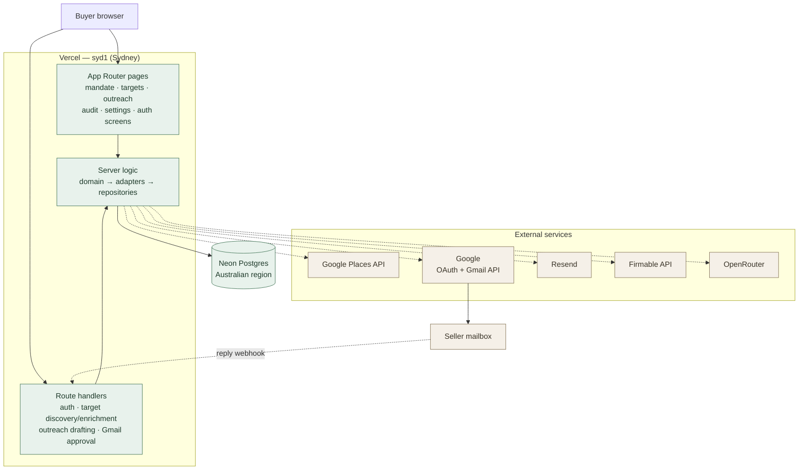
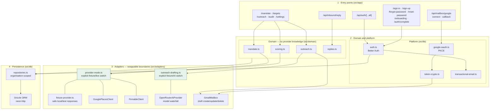
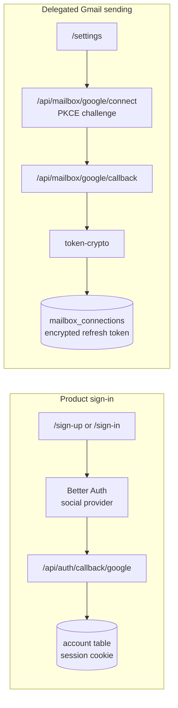
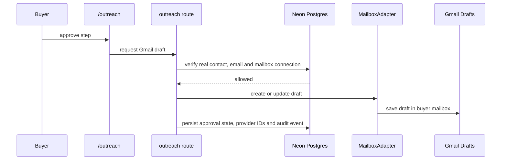

# Architecture

The state of the system as built. Everything runs as one Next.js deployment on Vercel pinned to `syd1`; the only stateful component we own is Neon Postgres.

## Infrastructure

Dotted edges are the ones that leave our infrastructure. External discovery and drafting are selected explicitly with `TARGET_DATA_PROVIDER` and `OUTREACH_DRAFTING_PROVIDER`; fixture mode makes no provider requests. Gmail approval always requires an explicitly connected mailbox and only creates a draft—it does not send.

## Module layering

Green nodes are explicit provider boundaries. `.env.example` selects fixture target data and fixture drafting so a fresh local clone and automated tests make no external provider requests. Production must explicitly select `TARGET_DATA_PROVIDER=live` and `OUTREACH_DRAFTING_PROVIDER=ai`.

Two rules hold the layering together: the domain layer has no knowledge of any provider, and nothing above layer 4 touches the database except through the organisation-scoped repositories.

## Two separate Google grants

Product sign-in and mailbox sending use the same Google project but are deliberately different flows, with different callbacks and different token stores.

Signing in never grants send scope. Connecting a mailbox is an explicit second act from Settings.

## Outreach send and reply

Approval guards are enforced before Gmail is called. Fictionalised contacts, missing email addresses, do-not-contact records and unconnected mailboxes cannot create Gmail drafts. Sending remains outside the current product flow.

## Data

One Neon Postgres database. All product tables are organisation-scoped and reached only through `src/db/repositories.ts`.

| Group | Tables |
| --- | --- |
| Identity | `user`, `session`, `account`, `verification` |
| Tenancy | `organization`, `member`, `invitation` |
| Sourcing | `mandates`, `targets`, `contacts`, `signals` |
| Outreach | `sequences`, `sequence_enrolments`, `messages`, `replies`, `suppressions`, `daily_send_counters` |
| Mailbox | `mailbox_connections`; legacy `mock_mailbox_deliveries` remains in the schema pending a separately approved migration |
| Trail | `audit_events` |

Schema lives in `src/db/schema.ts`. Migrations are checked-in SQL under `drizzle/` and are never applied without explicit approval for that specific migration.

## Why these boundaries

- **The domain knows nothing about providers.** Scoring, mandate parsing, sequencing, and reply handling are pure and deterministic, which is why they carry the test coverage.
- **Every external dependency sits behind an explicit provider boundary.** Fixture mode supports local development and automated tests; live mode uses Google Places, Firmable, OpenRouter and Gmail only for user-triggered operations.
- **Sovereignty is a deployment property, not a code property.** The `syd1` pin in `vercel.json` and an Australian Neon region keep request handling and data in-country without the application needing to know.
