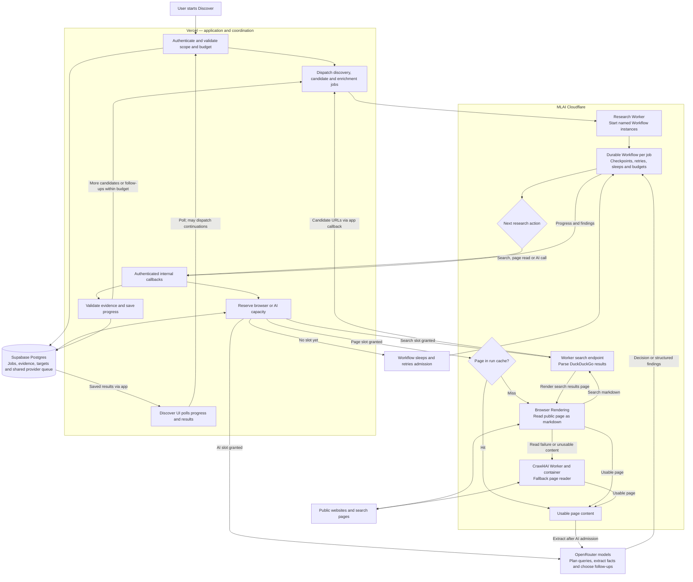

# Production agentic research architecture

The Vercel application owns authentication, research configuration, database writes, evidence validation, and job dispatch. Cloudflare Workflows execute resumable research jobs. Supabase stores the shared job state and provider reservations; the Workers reach it through authenticated Vercel callbacks.

Search result snippets supply leads rather than verified evidence. Company pages provide facts which are checked before saving. The diagram shows the main production path; legacy asynchronous crawl support and local Docker development services are omitted.

Browser page reads and web searches share account-wide admission control. The AI provider has its own admission policy. Multiple jobs can be active while most are waiting for a browser or AI slot. A partial job can still contain useful evidence, or can represent an unsuccessful read; it is not equivalent to a clean success.

The adaptive loop generates the next query from scope, previous searches and candidate outcomes. Candidates become separate jobs, and automatic continuations keep searching until the target or configured budget/deadline is reached. UI polling also performs recovery and dispatch checks, so it is part of coordination rather than a purely passive read.
