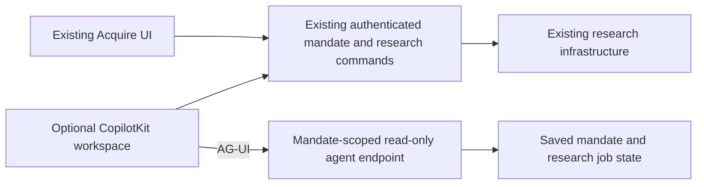

# Agent mode exploration

Current status (17 October): this worktree has progressed beyond the initial research-only exploration. Native supervision, reviewed research/contact/sequence tools, budgeted chat planning, email decisions, human handoff and recovery controls are implemented and under integration testing. Original UI/n8n remains supported. Direct MIT AG-UI replaced the installed CopilotKit wrapper after its production licence warning; no hosted CopilotKit Intelligence dependency is used. No live outreach or release is claimed.

Current evidence: docs/communications/progress.md. Completion ledger: docs/45-agent-delivery-checklist.md. Operator/stop/release guide: docs/43-agent-local-release-runbook.md. Specific pending schema approval: docs/46-agent-final-local-migrations.md. Native and communications execution remain disabled in the isolated preview while final acceptance is pending.

The remainder records the original exploration checkpoint and is historical; statements about missing tools/persistence or the original wrapper are not current implementation claims.

## Workspace and scope

User authorised exploration in a separate worktree/branch on 16 October 2026.

- Worktree: `../project-acquire-agent-mode`
- Branch: `codex/agent-mode-exploration`
- Base: local main `1d8a8f5` (two commits ahead of freshly fetched `origin/main` at creation).
- Main's existing uncommitted progress notes and output files were left intact.

The main interface retains its existing form, navigation and company screens. An opt-in Agent mode switch sits below the mandate description. The alternate workspace uses actual CopilotKit React v2 hooks and an AG-UI HttpAgent connected to an Acquire endpoint, rather than adopting the OpenDots application.

This is deliberately a guided interface exploration, not a functioning autonomous acquisition agent. Natural-language planning, continuous supervision, saved conversation history, outreach, scheduling and meeting booking remain unimplemented. No new sending authority or channel connection is introduced.

## Trying it

Set `AGENT_MODE_EXPLORATION_ENABLED=true` in this worktree's own ignored local configuration. The default is false. The setting gates the entry points, page and API; the static home/new pages also need a rebuild when changing the flag in a production build.

Use the normal approved local authentication/database/research setup. Do not copy production credentials or apply migrations as part of setup. This slice requires no new schema. For UI-only work without configured research, enable Agent mode and select Run demo to inspect a generated fixture plan before saving anything. The normal startup script can operate shared local containers; choose isolated ports/services and review its effects before using it for this worktree.

1. Open home or `/mandates/new`.
2. Enable Agent mode; the main action becomes Review agent plan.
3. Supply a brief (uses the existing generation endpoint) or select Run demo (uses a fictional local brief).
4. Review the description, extracted provisional criteria and research-only scope. No mandate is saved or research dispatched at this stage.
5. Explicitly choose Save mandate and start research. This uses the existing mandate creation and research POST endpoints and may use configured paid research providers.
6. Continue at `/mandates/<id>/agent`, or follow Open agent workspace from an existing mandate's brief/company page.
7. Ask Show mandate, Show research status, or Explain boundaries. The guided dispatcher reads server-owned saved state; unsupported instructions explicitly take no action.

The workspace offers refresh and an explicit Start company research action. It uses the same existing pipeline, not another scheduler. The chat and read-only refresh do not dispatch recovery or work. Job counts are not company counts. Returning to the main workspace retains its existing research and company controls.

## Boundaries and architecture

- `/api/mandates/[id]/agent` supports GET snapshots and POST AG-UI text/state events.
- Both reads recheck the session/current organisation and scope mandate/research queries to that organisation. Browser POSTs also enforce the existing Origin/content-type guard.
- Client-supplied thread IDs, system messages, state, context, tool definitions and forwarded properties do not grant capabilities or choose a tenant. Only the last 12 user/assistant text turns are included as untrusted conversation context; each is capped at5,000 characters. System/tool messages are excluded.
- The endpoint has no send, booking, mutation or research-dispatch tool. It calls the existing FreeOpenRouter adapter with the approved mandate model allowlist, zero-price cap for the ordered free pool, bounded paid fallback and output and a45-second adapter deadline. Each turn includes freshly loaded server state. There are no execution tools.
- The guided conversation exists only in memory while the page remains mounted. Acquire remains authoritative for business records. There is no CopilotKit Intelligence account or hosted thread dependency in this slice.
- The existing research GET can perform recovery, so the new snapshot deliberately uses a repository read instead. Snapshot reads do not establish provider health or durable liveness.
- Rapid approval clicks are fenced synchronously. A research retry retains its request key and previously saved mandate ID. This is not a general server-side mandate-create idempotency guarantee: an unknown mandate-save response still needs reconciliation before a production autonomy layer can safely retry.
- Snapshot job reads use the existing repository's 1,000-job cap. Counts describe that loaded snapshot, not an uncapped lifetime ledger.
- CopilotKit is imported only by the alternate workspace. Its package adds a substantial transitive dependency tree; bundle/cost/security review is still needed before adoption or release. `@scarf/scarf` install-time telemetry is explicitly disallowed in pnpm build policy. The documented server telemetry opt-out is included in `.env.example`.

## Local evidence

- Tests were written before domain/API/UI modules; their initial executions failed because the new modules did not exist. These are not represented as behavioural assertion failures.
- Meaningful RED: rapid approval clicks created two mandate-save requests, and uncertain research retry generated a different request key. Both dedicated tests failed before the guard/key changes; both passed afterward.
- Scoped verification: 53 tests passed across 8 files, including 21 new cases covering form orchestration, scope, API isolation, stale/partial/failed status and decoding by the actual `@ag-ui/client` HttpAgent. Repository/authentication responses are synthetic; these are not live database or provider tests.
- Full Vitest: 4,164 passed, 338 opt-in skipped, one failed. Failure: `src/app/workspace-routing.test.tsx:68` expects a server-side home repository call although main now renders the cached creation component. Restoring the three original main creation files and rerunning that suite reproduced the identical failure (8 passed, 1 failed). Original files were restored to the exploration implementation afterward. That unrelated test was not changed.
- Native Node checks: 39 passed.
- Route type generation, TypeScript and changed-file ESLint pass.
- Ordinary Webpack build failed fetching Jost from Google Fonts (network timeout). A build with synthetic unavailable DB/auth settings and **font-response fixtures only** passed compilation, types, prerendering and route tracing. This verifies build compatibility, not real font delivery or deployment. Private fixture: `.local-data/agent-mode-verification/google-fonts.cjs`.
- Chrome displayed the existing home form plus the new switch with the flag enabled. The isolated server had no authenticated session and redirected to sign-in; authenticated end-to-end browser flow and a live saved mandate were not verified. The server was stopped. No auth bypass, credential loading, real database write or provider request was used to overcome this boundary.
- No migration, live research/enrichment operation, message, booking, release, push or deployment was performed.

## Next slice

The fixed dispatcher has been replaced with bounded read-only model conversation (see the October16 follow-up below). Next add typed Acquire planning tools while retaining this interface and authoritative backend boundaries. First persist/version operating authority and run state, with an exact schema proposal for separate approval; bind review decisions to the relevant mandate revision. Then demonstrate authenticated local end-to-end research and restart/reconnect behaviour before claiming always-on execution. Outreach and conversational reply tools must preserve the communications plan's admission, historical bindings, unknown-send reconciliation and person holds; chat approval is not send authority.

References: [CopilotKit](https://github.com/CopilotKit/CopilotKit), [OpenDots](https://github.com/CopilotKit/OpenDots), [AG-UI](https://docs.ag-ui.com/introduction), [CopilotKit runtime](https://docs.copilotkit.ai/strands/backend/copilot-runtime), [AI SDK/custom backend integration](https://docs.copilotkit.ai/agent-spec/backend/custom-agent).

## OrbStack test instance — 16 October

User requested a runnable OrbStack instance. `ops/agent-mode/compose.local.yml` and `scripts/start-agent-mode-orbstack.mjs` now run this worktree at **http://acquire-agent.orb.local**. App container `project-acquire-agent-mode` binds loopback3026; `project-acquire-agent-research` runs the local worker without a published port. Linux dependencies, Next cache and worker state have separate named volumes. The dependency installer shares the existing Mac pnpm package cache, after cold container downloads/policy lookups timed out; policy checks were not disabled. Source is read-only except an ignored isolated generated `next-env.d.ts` mount needed by Next dev. See `ops/agent-mode/README.md` for start/stop and origin fallback.

The existing local PostgreSQL database on5434 is reused. Its tables and93 existing mandate records were inspected read-only; nothing was seeded, copied, restored or migrated. This is process/state isolation, not a separate application database: user actions can change normal local mandate records. Only research/model credentials were selected from the main local configuration into ignored0600 files. Messaging, cloud-infrastructure and Firmable browser credentials were not copied. Communications runtime and n8n campaign execution are false; provider connections are unconfigured. Local research can use paid providers when the user explicitly starts it.

Operational verification: app and worker containers are running; OrbStack app health200, sign-in200, anonymous acquisition-session401, authenticated local database readiness200, and worker authentication boundary401. Chrome reached the expected sign-in screen and the tab was retained. Existing local email/password accounts are supported; Google OAuth is not configured for the additional origin. Authenticated end-to-end execution remains for the user to test; no login bypass or provider operation was used for these checks. The initial read-only generated-types error was fixed with the isolated generated-file mount, and a fresh app log has no such error. Starter/install scripts pass syntax checks, Compose validates, and diff whitespace checks pass. This is local-only operational setup, not a production release or a new full-suite verification.

## Natural conversation follow-up — 16 October

The initial fixed-command dispatcher rejected “hows it going”. The agent endpoint now uses the existing FreeOpenRouter adapter to answer arbitrary mandate/research questions, with fresh saved state plus a bounded12-turn transcript. Client system/tool messages are excluded; client assistant history is explicitly untrusted. The model has no tools and cannot dispatch research, edit records, send or book. Provider failure returns an honest503 rather than a simulated successful answer. The UI now says AI answers use saved data and updates its status card after successful conversation runs. Conversations remain temporary; no schema change or durable agent run was introduced. The subsequently authorised policy is free-first with bounded paid fallback; see the model-waterfall follow-up below. Existing explicit research commands retain their normal budgets.

## Research wiring corrections — 16 October

The initial OrbStack setup passed process health but missed authenticated Worker bindings and local connection validators. The worker now loads the allowlisted ignored environment file as /config/.dev.vars, shares the app network namespace for loopback callbacks, and uses a fixed reader relay on loopback18083. Existing strict callback/reader/search validators remain unchanged. Authenticated worker access and anonymous refusal are checked by the launcher before printing readiness. Shared OpenSERP timed out; the preview uses the existing reader-based search path instead, verified with real search-result markdown. See docs/communications/progress.md for exact evidence and job outcomes. The original queued run and automatic continuations are now terminal, with no saved companies. A fresh authenticated full research run remains to be verified; browser sign-in is required. The agent snapshot now separates queued/executing jobs and provides recent saved messages, timestamps and counters, addressing the misleading earlier active summary.

## User-authorised temporary model waterfall — 16 October

OpenRouter calls now allow provider data collection. Replaced unavailable NEX/Qwen free routes with Dots3 Note Preview, Nemotron3.5 Super VL and Nemotron3 Super120B, in that order. All three passed live business and people extraction schemas using synthetic, quote-grounded fixtures. Free routes retain a zero-price cap. Eligible failure falls through to Mercury2.5 then NeMo; both paid attempts share the existing45-second total deadline and$0.04/M input,$0.15/M output cap. NeMo omits unsupported reasoning controls. Request/account errors stop retrying, and schema validation remains mandatory. Qwen3.7 Flash is excluded because strict-schema routing failed. Mandate descriptions no longer bypass free inference for a paid primary; the existing final OpenAI brief fallback remains available. Chat and scope generation no longer force free-only mode. The local launcher explicitly selects free-primary mode for its worker. Existing research time/page/model-call budgets and communications admission are unchanged. No account privacy setting or production deployment was changed.

## Initial release scope and local build authority — 17 October 2026

The user narrowed v1 to mandate → research → qualification → authorised outreach sequence → interested prospect → human booking-link handoff. A human reviews the conversation and sends the booking link. Automatic link sending, calendar integration and automatic booking are future scope, not v1 dependencies. Preserve cross-channel reply holds and persist human ownership so queued agent actions cannot continue contacting the person. Track interested, awaiting human, link sent and meeting confirmed separately; handing off or sending a link is not a booked meeting.

Plane delivery module: https://plane.mlai.au/mlai/projects/049211e4-72a2-4ee3-9257-157a4f11822f/modules/c37a4ce4-823e-449e-b503-ea94a83d13b3 . AG11 / L0D499CD9-129 now specifies the durable handoff, owner/task/notification, explicit manual send and duplicate/race recovery. All 22 module work items require task-specific testing at pre-implementation, integration and acceptance checkpoints. Preserve historical completed work; add integration regression evidence rather than reopening foundations or treating old results as current verification.

The user explicitly authorised discretionary database migrations for this worktree’s local OrbStack build environment. This is a session-specific exception to earlier per-migration approval wording for that local scope only. The current preview shares main’s local PostgreSQL database: before using the permission, establish a dedicated agent-worktree database/role or instance and verify both app and worker connections target it. Do not apply these migrations to the shared-main database, another worktree, UAT or production under this permission. Record migration artifacts, exact local target, data preservation and schema/compatibility test outcomes. No migration was performed as part of this planning update. This permission does not authorise live outreach or release.

Next implementation action: establish isolated local persistence, then implement shared commands and migration-backed agent state with the task-specific tests. Runtime behavior remains at the earlier exploration status until separately implemented and verified.

## V1 scoped memory, feedback and evaluation — 17 October 2026

User approved adding learning to the design/backlog. Plane now has 23 module issues: AG15 / L0D499CD9-133 (https://plane.mlai.au/mlai/browse/L0D499CD9-133/) covers scoped versioned memory, explicit human feedback and outcome evaluation. Eighteen related existing tickets were updated with integration acceptance and additional tests; all 23 have testing plans. Existing workflow states were preserved. Verification: output/opendots-architecture-review/plane-learning-verification.json.

V1 stores candidate versus approved guidance, provenance, source/entity versions, feedback reasons, applicable scope, edit/reject/revoke history and applied-guidance references in existing Postgres. Retrieve only relevant approved guidance within bounded context/cost before a decision or wake-up. Do not treat prospect/web content, model summaries or a draft edit alone as an approved general instruction. Keep human preferences separate from sourced company facts. Current explicit instructions, mandate criteria, operating authority, budgets and person/human-takeover holds remain authoritative; any changes to them need their own explicit versioned decision. Revalidate affected guidance/revisions before effectful dispatch after an edit/revocation.

Capture qualification/draft/handoff outcomes and corrections with provenance; evaluate baseline versus memory-assisted quality/cost on held-out cases before reviewed prompt/model releases. No vector database, fine-tuning, online self-training or cross-customer memory is needed. Broader reuse/approval roles remain a product decision. Proposed initial default is explicit confirmation and mandate-only guidance, not an agreed broader reuse policy.

Open pre-build product questions are recorded under STU-313: first channel/test cohort, initial targeting/sequence send approval, memory scope/approver and first pilot mandate/human handoff owner. Local tests can start with fictional data/owned accounts; prospective contact limits/spend caps must be agreed before live pilot execution. No implementation, migration, live send or deployment occurred in this backlog update.

## Approved pre-build product decisions — 17 October 2026

The user answered the pre-build questions: email is the first complete channel; human-in-the-loop interaction uses Frank-style chat cards/buttons; reply drafts require human approval by default, with an exact-current-batch Approve all option and optional explicitly enabled YOLO mode. The pilot must use existing local test-run mandates and their saved DB data rather than requiring a new fictional mandate. Earlier open-question/default suggestions above are historical and superseded by these answers.

Implementation interpretation: approval cards preview concrete targets/sequence/draft/account/version/effect and expose approve/edit/reject/takeover actions. Approve all binds to the presented batch, not future work. YOLO is a versioned, scoped, expiring/revocable grant for eligible actions within existing budget/volume/account limits; it is not a bypass for suppression, unknown-send reconciliation, owner/tenant controls or human takeover. Cold-campaign reply holds remain intact; any delegated conversational reply is admitted through a separate reply authority path. Human takeover prevents agent outbound. Meeting-ready interest still creates the persistent human task and agent-to-human chat message; a human sends the booking link. Memory promotion stays explicit even with outbound YOLO enabled.

Local-first build is ready with these product choices. First inventory existing local test-run mandates and dependencies read-only, then copy selected local test records with provenance/FK mapping into isolated agent-worktree persistence before using the local migration permission. Do not copy provider secrets or inherit executable account/campaign authority from historical records. Review/choose owned test-account bindings and effective limits before live-account testing; initial local delivery uses controlled sinks. No additional product question blocks local foundations. No implementation/migration/copy/live sending/deployment is performed by this planning update.

## Foundation build checkpoint and revised execution plan — 17 October 2026

The user directed continued implementation and clarified dual execution: retain n8n for original-UI structured sequences; native agent conversations reason from the mandate/current history without requiring n8n or a sequence graph. Accepted plan: [41-goal-driven-agent-execution.md](41-goal-driven-agent-execution.md). Plane has 24 issues; AG16 / L0D499CD9-154 adds exclusive ownership and explicit handover. The older sequence-only assumptions above are superseded.

The preview is now on its **own** OrbStack Postgres container/database (`project-acquire-agent-postgres` / `acquire_agent_mode`, host5437), populated from existing local test data with source IDs/provenance retained. No provider connections, active enrolments or sessions were copied; original local credential-password accounts can sign in. Source/main local database remains unchanged. Three hashed forward migrations establish the agent state/role/scope/history foundation. See [OrbStack README](../ops/agent-mode/README.md) for explicit preparation and migration commands and the communications progress entry for exact artifact hashes and RED/GREEN evidence.

Implemented: shared typed read commands in both manual/agent routes; owner-scoped durable threads/messages/proposals/outbox and fenced leased event claims; native contextual decision validation. Locally verified with 48 targeted tests (12 real Postgres),43 Node checks, TypeScript and changed-file lint. Full Vitest has 4,212 passes/338 skips and the previously documented home-routing test failure. This is not completed AG01/AG02 or a shipped autonomous agent: conversation UI is still temporary/read-only, approval/ownership/worker integration and live E2E remain outstanding. No communications/provider operation or production release occurred.

## Persistent-chat build checkpoint — 17 October 2026

Durable owner-scoped conversation storage is now connected to the agent page and authenticated API in the isolated OrbStack preview. Reload/refresh rehydrates saved messages; duplicate completed requests reuse the saved answer without another model call; cancelled or expired turns cannot commit late output. Actual signed-in browser rehydration was verified with synthetic-account history on an existing pilot mandate. This does not complete the autonomous worker, tools or outreach integration.

The latest user-provided AGENTS.md now requires explicit approval for each specific migration, including local. Earlier discretionary local permission is superseded for future migration execution. `0005-agent-review-state.sql` is a concrete review artifact awaiting approval, not an applied migration. The strict review/bounded delegation policy has unit evidence, while durable approval/consumption and dispatch/UI integration remain unfinished. See `docs/communications/progress.md` for exact evidence, current gaps and the next action. The24-item module remains in progress; no production/live-send completion claim.
