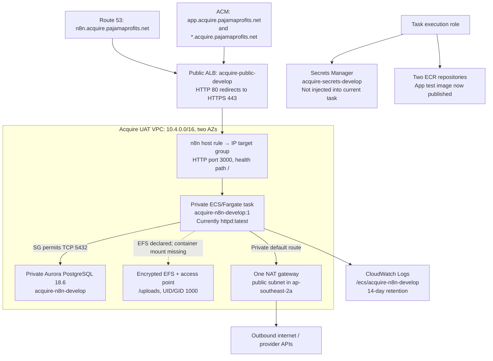
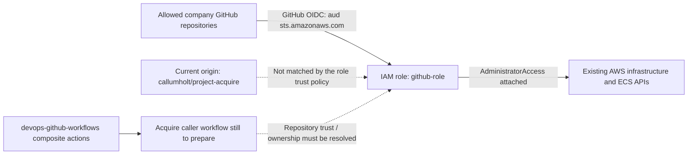

# AWS UAT resource map

Observed: 2026-10-20; configuration metadata refreshed on 2026-10-21 with62/62 successful read checks. The user confirmed **`develop` is UAT**, and only UAT is provisioned for this migration. Production is a later phase, after UAT is deployed and accepted. DevOps owns infrastructure; application deployment is separate.

Account: `352329340196`. Workload region: `ap-southeast-2` (Sydney). AWS profile: `acquire`, with verified renewable SSO login; Identity Center itself is in `us-east-1`. The earlier `acquire-session` temporary credentials have expired. Project `.env.local` now references `acquire`.

This map records configuration metadata and bounded public endpoint checks. It does not establish database content/compatibility, secret contents, private runtime connectivity or successful application deployment. No AWS configuration was changed.

**October23 separate database verification:** user-authorized catalog inspection through the existing ECS Session Manager path now proves private Aurora connectivity, certificate/hostname validation and TLS1.3. The only non-template databases are `rdsadmin`, `postgres` and `n8n`; `acquire` is absent, and the only non-system login is the cluster master. Shared-secret database credentials were used in process memory for catalog reads in `postgres`, with explicit read-only transaction and rollback; no app/n8n rows or password hashes were queried. This supersedes the earlier unknown logical database status, not full schema/RLS/runtime-role readiness. The tunnel was terminated; no resources, database/users/schema, grants or deployments changed. See [the detailed readiness result](../ops/aws/README.md#october23-live-database-readiness-check).

## Current topology

Solid arrows below show configured routes, bindings or permissions; private database access is not a completed runtime test. The dashed EFS connection identifies the missing container mount.

The public n8n URL resolves and returns HTTPS 200 with a valid certificate, but its page title is **“It works! Apache httpd”**. The ALB target is healthy because it serves that placeholder. n8n itself is not deployed. The certified `app.acquire.pajamaprofits.net` hostname currently does not resolve and has no application routing/service configured in this cluster.

## Resources and deployment identifiers

| Component | Existing UAT configuration | What we can use / what remains |
| --- | --- | --- |
| VPC | `vpc-094cec961e54f87f0`, CIDR `10.4.0.0/16` | Dedicated Acquire network. The account's default VPC is outside this map. |
| Public subnets | `10.4.10.0/24` in `2a`; `10.4.11.0/24` in `2b` | ALB and outbound NAT infrastructure. |
| Private app subnets | `10.4.1.0/24` in `2a`; `10.4.2.0/24` in `2b` | Existing ECS service and EFS mount targets; tasks have no public IP. |
| Database subnets | `10.4.20.0/24` in `2a`; `10.4.21.0/24` in `2b` | Private Aurora subnet group. |
| Outbound routing | Both app subnets use one NAT gateway in `2a`; no VPC endpoints found | Existing configured route for provider APIs, image pulls and AWS services. This has a single-AZ NAT dependency. Database subnets have no explicit public/NAT route association and use the local-only main route table. |
| ECS cluster | `acquire-acquire-develop` | Can host the initial UAT services. Only the n8n-named placeholder service exists. |
| ECS service / task family | `acquire-n8n-develop`, current revision `1` | One desired/running Fargate task, 256 CPU units / 512 MiB, private networking, ECS Exec enabled. |
| Current container | `n8n`, image `httpd:latest`, port `3000` | No environment variables, secret injections or mounts. Replace with the reviewed n8n image/configuration after database-startup approval requirements are addressed. |
| Release behavior | Rolling, minimum healthy 100%, maximum 200%; circuit-breaker rollback disabled | Allows overlapping tasks. Prepare a single-active n8n deployment strategy and explicit rollback. |
| ECR | `acquire-n8n-develop`; `acquire-acquire-develop` | Immutable tags, scan on push, AES256 encryption. App image publication verified on October21 under `app-local-test-20261021T114343Z`; n8n repository remains empty. Communications image/repository ownership still needs deciding. |
| Application / communications | No corresponding ECS services in the inspected cluster | Add reviewed task definitions, roles/security-group access and routing through the owning infrastructure/pipeline. |
| Aurora cluster | `acquire-n8n-develop`, engine `aurora-postgresql` version `18.6` | Initial database `n8n`; October23 catalog reads confirm no `acquire` database or dedicated non-system app login. Private connectivity/TLS verified separately; source/target compatibility, app schema and runtime-role acceptance are not proven. |
| Aurora instance | `acquire-n8n-0-develop`, `db.serverless`, private | Single writer; scaling 0–2 ACUs, auto-pause after 300 seconds. Test wake-up latency/retries for UAT. |
| Database recovery/transport | Seven-day backups, deletion protection, encryption enabled, CA `rds-ca-rsa2048-g1` | IAM DB authentication disabled. Validate client TLS, role/RLS parity and exact approved initialization/restore before startup. |
| EFS | `fs-0af097cbfff6960bd`, `acquire-n8n-develop`, elastic throughput | Encrypted, automatic backup policy enabled, mount target in each private app subnet. Backup configuration is not a restore test or proof of completed backups. |
| EFS access point | `acquire-n8n-uploads-develop`, `fsap-0c0eb0b5f3dc301f2` | Root `/uploads`, UID/GID 1000, permissions `0755`; task volume uses IAM authorization and transit encryption. No container mount currently uses it. Agree mapping to `/home/node/.n8n` or a separate appropriate access point before moving n8n files. |
| Secrets Manager | `acquire-secrets-develop` | Exists; task execution role can retrieve it. October23 DB inspection used the existing cluster username/password in memory, without output or project persistence. No dedicated app secret was discovered; app configuration/isolation remain incomplete. No custom KMS key is specified in shared-secret metadata. |
| SSM Parameter Store | No parameters matched `acquire` | No project parameter configuration discovered. |
| Private discovery | No namespace returned | Choose private service routing for app → communications when those services are defined. |

Exact subnet IDs, endpoint addresses, resource ARNs, roles/policy documents and image digests are in the ignored machine-readable inventory, rather than credentials or source-controlled configuration.

## Ingress, DNS and certificates

| Item | Verified configuration |
| --- | --- |
| Hosted zone | Public Route 53 zone `acquire.pajamaprofits.net`. |
| n8n DNS | CNAME `n8n.acquire.pajamaprofits.net` → the public Acquire ALB; externally resolves. |
| ACM | Issued certificate for `app.acquire.pajamaprofits.net` and `*.acquire.pajamaprofits.net`, attached to ALB HTTPS listener, DNS validation succeeded. |
| HTTP | Port 80 redirects to HTTPS 443. |
| HTTPS | n8n host rule forwards to `acquire-n8n-develop`, IP targets on HTTP3000. Unmatched hosts receive fixed503. |
| App hostname | Certificate covers it, but DNS lookup failed and no app forwarding rule exists in the inspected listener. |
| Communications hostname | No corresponding DNS record, listener rule or service discovered; public webhook/tracking versus private API routing needs defining. |
| Timeouts | ALB idle timeout60s, target deregistration delay300s; task stop timeout unspecified. Align with actual request/drain behavior before deployment. |
| Access logging | ALB S3 access/connection/health logs disabled. CloudWatch container logging is configured separately. |

Security-group paths:

| Source | Destination | Allowed inbound |
| --- | --- | --- |
| Internet | `acquire-alb-develop` | TCP80/443 |
| ALB group | `acquire-n8n-develop` task group | TCP3000 |
| n8n task group | `acquire-rds-develop` | TCP5432 |
| n8n task group | `acquire-efs-develop` | TCP2049 |

The non-default project groups allow all outbound traffic. There are no app/communications-specific group paths yet. Choose the intended n8n listening port explicitly: retain3000 through configuration or update its task, target group and rules together; do not assume the default n8n port already matches.

## GitHub deployment and IAM

| Role / provider | Verified contract |
| --- | --- |
| GitHub OIDC provider | `token.actions.githubusercontent.com`, audience `sts.amazonaws.com`. |
| Deployment role | `arn:aws:iam::352329340196:role/github-role`; attached policy `AdministratorAccess`. AWS metadata shows the existing ECS service was created by this role. No GitHub token was requested or role-assumption/write test executed. |
| Trusted subjects | `repo:Sansoni-Management-Dev-Team/*`, `repo:Sansoni-Management-Dev-Team@191077480/*`, `repo:aaronsansonideveloper/*`, as written in the policy. |
| Current app origin | `https://github.com/callumholt/project-acquire.git`; it does not match those trust subjects. Deployment needs a company-owned caller repository or a reviewed trust-policy change for the intended repository/branch/environment. No repository move or trust change is implied. |
| Task execution role | `acquire-ecs-task-execution-develop`: managed ECS execution policy for ECR pull/logging plus inline `GetSecretValue` permission for `acquire-secrets-develop-*`. |
| n8n task role | `acquire-n8n-develop`: ECS Exec message-channel actions and EFS `ClientMount`/`ClientWrite` through mount targets. Database credentials/access are a separate configuration boundary. |

The shared deployment-actions repository was reviewed at commit `17bd7357c7a3dff1ae12fd0e3f56f90c21093bb3`. It provides OIDC role assumption, ECS task registration and service update/stability helpers. Its task-registration action does not pass task-level EFS volumes; extend it or agree a full-task-definition path. Define which task/service properties Terraform owns before an app pipeline changes revisions.

The tagged infrastructure repository, `Sansoni-Management-Dev-Team/devops-infrastructure-acquire`, still returns404 for the current GitHub identity. Terraform code/state and the intended application caller workflow cannot yet be inspected. AWS access is now sufficient to discover role identifiers; a role ARN is no longer missing information.

## Logging, encryption and recovery

- Container logs: `/ecs/acquire-n8n-develop`, standard CloudWatch log group, 14-day retention. Current task sends `awslogs` output there. No application log events or log payloads were retrieved.
- Alarms: no metric/composite alarms matched Acquire names or Acquire dimensions/rule references in the inspected regional results. Shared externally managed alerts were not assessed.
- Aurora: encrypted with an enabled customer-managed symmetric KMS key; seven-day automated-backup retention and deletion protection configured. CloudWatch database log exports are absent; enhanced monitoring interval is0 and Performance Insights is disabled.
- EFS: a separate enabled customer-managed symmetric KMS key, IAM-authenticated/transit-encrypted task-volume configuration and automatic-backup policy enabled. Both inspected KMS policies delegate authorization through the account root/IAM policy mechanism. Data-key material was not accessed.
- CloudWatch log-group metadata has no custom KMS key configured. Secrets metadata has no custom key configured. These observations are configuration fields, not an assertion that service-default encryption is absent.
- Restoreability, backup job outcomes, RTO/RPO, PostgreSQL18 compatibility and actual n8n credentials/workflow/wait recovery remain rehearsal work.

## Work remaining for the first UAT deployment

October21 ownership clarification: DevOps should provision the missing app resources through its own infrastructure process and return the app service/base task/secret/routing configuration. The application operator does not need to take over Terraform or obtain its state to deploy to a correctly prepared service. The refreshed inventory still shows only the n8n-named placeholder, no app/communications service, no app target group/DNS/security group/log group, and only the existing n8n/shared roles and secret metadata. Application logical database/user/schema readiness remains unverified, not proven absent. See the [app-only DevOps handoff](../ops/aws/README.md#ownership-and-current-deployment-blocker). No app launch was attempted against missing prerequisites.

1. Obtain infrastructure-repository access and agree the GitHub caller location/trust, Terraform ownership and shared-action volume-registration approach.
2. Define app and communications tasks/services, routing/security-group paths, image locations, secrets and environment-specific origins. Existing app certificate/ECR naming provide starting resources; they do not constitute deployed application services.
3. Replace the n8n placeholder with a reviewed pinned image, correctly mount persistent files, configure the database/secret fields and ports, and prevent deployment overlap. Preserve the original encryption key and waiting executions according to the chosen UAT fixture/migration scope.
4. Prepare exact UAT database artifacts/targets for approval, including automatic n8n startup changes. Prove compatibility and isolation; no application or scheduler startup against a database is authorized by this inventory.
5. Validate TLS, health/readiness, shutdown/drain, callback isolation, logging/alerts, persistence and restore. Use isolated/synthetic messaging authority; production accounts and source schedulers remain unchanged.

Production provisioning and cutover follow UAT acceptance. Missing production resources or decisions are not blockers for documenting and preparing this UAT baseline.

## Evidence and refresh

- Human plan: [AWS Fargate migration plan](40-aws-fargate-migration-plan.md).
- Metadata inventory: `.local-data/aws-migration/uat-inventory.json` —62 successful read checks, no failed checks in this run.
- Public endpoint evidence: `.local-data/aws-migration/uat-endpoint-checks.json` —TLS-validated n8n placeholder response and app DNS result.
- Relationship map: `.local-data/aws-migration/uat-resource-map.json` —machine-readable nodes, edges and deployment gaps.
- Read-only refresh helper: `.local-data/aws-migration/inspect-uat.py`; uses explicit profile `acquire`, fixed account/region validation, an allowlist of read operations and metadata-only projections. It excludes secret retrieval, database connections, ECS Exec and log-event access. Recheck the source before using it to refresh a later inventory; it assumes the current UAT VPC/cluster identifiers.

Local artifacts are ignored and restricted. No credential values were copied into this document or the inventory. This is a planning/operational inspection record; it makes no application-test, migration, deployment or release claim.
