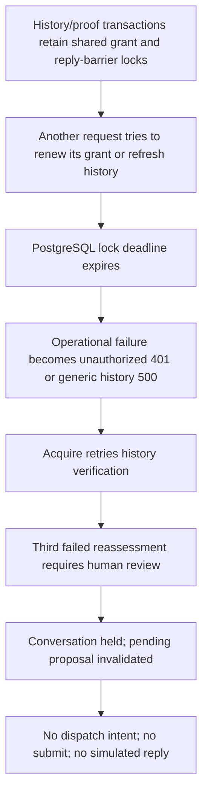

# Hosted simulator retry RCA — 23 October 2026

The retry stopped before sending. Actual hosted PostgreSQL logs establish lock contention in communications authorization and history maintenance. Acquire then exhausted its history-read retries, held the conversation and invalidated its pending draft. No recipient AI decision or reply occurred.

## Verified causal chain

The retained logs show twelve lock timeouts on `INSERT INTO communications.access_grants ... ON CONFLICT ... DO UPDATE` and one on `communications.lock_reply_barrier` during 21:40–22:01 UTC on22 October. They establish the failed statements and locked relations. They do not identify every blocking transaction or prove a PostgreSQL deadlock.

Ordinary hosted API authentication calls `authorizeSignedScope`, which writes the grant row. History/proof transactions read the same live grant `FOR SHARE`. Retaining that shared lock across callbacks prevents another transaction's renewal UPDATE until the proof finishes. The account-runtime SQL sets a one-second lock deadline. A valid credential can therefore encounter a database lock timeout.

The hosted auth wrapper catches renewal failures and returns false; `createScopedServiceAuth.verify` also collapses exceptions to null. The API maps null to401 before reading the request body. Thus this path reports availability failure as invalid authentication. The earlier app repair fixed concurrent membership callbacks and readiness reporting, but did not remove ordinary request grant-renewal contention.

History reads also perform recipient/account refresh, outbox consumption and application coverage projection. The reply barrier serializes this work with other maintenance. Its timeout and unexpected errors become generic500 at the HTTP boundary. In-process `HistoryRefreshBusyError` has a defer path in Acquire, but that typed distinction does not survive this generic hosted failure. The single retained500 is consistent with the same-window barrier timeout; absent a request correlation ID, the exact one-to-one pairing is not conclusively established.

## Saved application timeline

Scope: original test mandate `ae69ab0f-ae4b-462b-8825-60e917fa69d0`, Rod Cheater at splose, conversation `48a30d6a-6c98-4b79-8a8b-e7ca68de1c01`. Only its reserved simulator address was selected.

| UTC on22 October | Persisted fact |
|---|---|
|21:48:54.728|History ingestion created reassessment event `e4ca415c-0cf0-450f-9182-ff9ce515ccb4`, epoch3.|
|21:49:32.849–21:50:13.610|Attempt1 deferred because history could not be verified.|
|21:50:55.512–21:51:19.256|Attempt2 deferred for the same reason.|
|21:51:29.275|The script's normal proposal command saved email operation `09c1a8bc-64ad-425d-ba52-ea92512a714d` and pending review `53b55ec3-020a-4506-9e6b-3a3d3c003b1c`.|
|21:52:11.089|Attempt3 began under run `1d69fa93-352a-4fe1-8545-3dacf4683d88`.|
|21:52:47.360|`conversation.hold` `29f32e1e-e769-4376-91ad-c4d4aba9806e` committed: “Conversation history could not be verified after three attempts.” The same transaction failed the pending draft with `context_changed` and invalidated its review.|
|21:52:51.025|The worker recorded `human_review_required` and the original trigger event.|
|22:00:10.838|The test harness normally paused its responsibility. It did not clear the hold.|
|22:00:32.487|Read-only simulator store:0messages,0model calls,0decisions,0materialized leads.|

The hold was an engineering fallback before the model decision, not an LLM choosing to pause. The draft itself did not cause an AI refusal. The retained application event and run records, hold input and source handler establish this link.

## Layers and contributing factors

**Simulator/shared communications:** grant renewal requires an exclusive row lock on an ordinary authenticated request. Proofs retain shared grant locks across cross-service work. Transient SQL failures are misclassified as401; history/proof contention is exposed as500. The actual workload mixes maintenance, foreground reads and nested proof verification, while health uses a lighter advisory read. `200 ready` therefore does not prove a foreground history/dispatch path will succeed.

**Acquire:** its bounded history fallback deliberately converts three untyped failures to a human hold. That is fail-closed behavior, but operational contention should be distinguishable from a lead needing a human decision. Hold-driven review invalidation correctly prevents a stale draft from being sent. It is a downstream consequence, not an independent bad-approval defect.

**Test harness:** the script calls normal Acquire functions inside a separate process in the production app container. It does not exercise authenticated browser handlers. Its proposal ran while the actual background worker still owned a failing reassessment; this race allowed a draft to be saved shortly before the legitimate hold invalidated it. Later the script did not find a pending review and still entered dispatch; status authentication then failed before begin/intent creation. The harness should explicitly reconcile review/operation state and stop on invalidation. This does not explain the independently observed deployed-service SQL timeouts.

SSH timeouts, a local fallback missing container-provided `NODE_ENV`, local PostgreSQL connection failure, diagnostic SQL column mistakes and an initial CJS probe build failure were operator/harness failures. They are not evidence that the deployed app or simulator failed those same steps. Corrected read-only probes passed. No migration, missing-schema condition, invalid credential, token-expiry event, real-provider send or successful hosted AI round trip was demonstrated by this retry.

## Recommended repair order

1. Instrument each hosted request with fixed stage, generated correlation ID, elapsed time, SQLSTATE and outcome. Trace grant checks/renewals, proof callbacks and native history retries. Exclude credentials, contact details, prompts, message content, raw SQL parameters and raw exceptions.
2. Reproduce grant renewal versus an outstanding proof in an isolated existing test database, preserving its original security checks. Separate authentication denial from temporary storage failure. Consider validating the current unexpired grant for ordinary requests while a single owner renews it; preserve membership/revocation checks and real expiry. Do not simply increase TTL or disable locks.
3. Preserve typed temporary history/proof contention across the HTTPS boundary, with bounded read-only deferral rather than a false credential error. Do not retry an uncertain send or bypass strong admission/history checks.
4. Distinguish operational waiting from human lead review in Acquire, and reconcile exact original review/operation state in the harness before approval/dispatch.
5. Verify the failed original operation remains without an intent; then use normal explicit recovery/current-context review. Prove submit receipt, actual model decision, both saved conversation stores and committed event ACK separately. A healthy endpoint, successful trace or400 validation response is insufficient.

## Evidence and release boundaries

Actual releases inspected: Acquire image `29be0475b718…` (auth repair commit `813cea4`) and hosted simulator image `66620a39412a…`. These match the independently deployed repair, not the new tracing worktree. The simulator-owned PostgreSQL cluster is separate from Acquire's Supabase database.

Private evidence directory: agent-mode `.local-data/agent-mode-orbstack/evidence/hosted-production-release-20261022/`. Key files: `rca-postgres-retry-window.private.log`, `rca-hold-timeline-222118.private.json`, the original `hosted-e2e-refresh-email-*.private.log`, `hosted-e2e-send-email-215339.private.log`, and `retry-20261023-simulator-state.private.json`. Raw records remain ignored/restricted. No outreach or database migration was performed for this RCA. The recommended behavior fixes are not implemented or released by this report.
