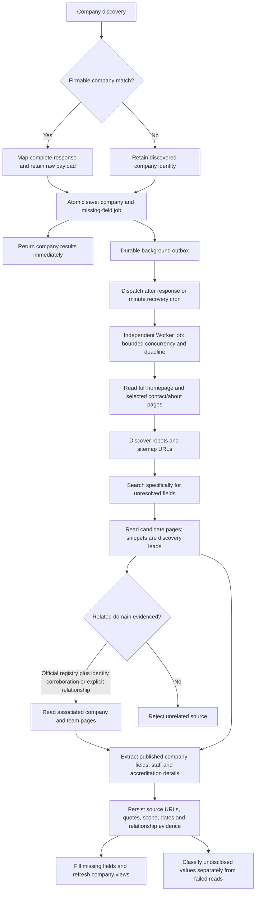

# Nonblocking company enrichment

Company retrieval maps and preserves the complete Firmable response, accepts its reported ABN with provider provenance, and commits the company plus a stable background job in one transaction. Missing provider fields do not delay or fail company completion. Unmatched companies commit their discovery identity immediately and queue the same public research path.

Shared changes extend the original 18-item acceptance matrix rather than introducing company-specific exceptions. They address RC-01/02/03 (source scope), RC-07 (unmatched company richness), RC-10 (lifecycle and deadlines), RC-11/14 (saved contact completeness), and RC-15/16/17 (identity/source distinctions). Historical verification remains historical; the current release has its own evidence below.

| Obligation | Regression and generalization | Integration |
| --- | --- | --- |
| Company completion never waits for optional retrieval | `src/lib/company-identity-boundary.integration.test.tsx`, internal callback route tests; failing/unmatched providers and slow dispatch | Worker workflow tests and company progress state/render tests |
| Queue is durable, idempotent and isolated | `src/lib/company-background-research.test.ts` | `src/db/company-background-research.integration.test.ts`; completed parent, callback replay, cancellation, organization boundary |
| Concurrency and deadlines are independent | Dispatcher uses organization advisory lock, stable Workflow IDs, two slots, execution-start deadline, bounded dispatch retries | `src/db/company-background-dispatch.integration.test.ts`; actual competing transactions, expired queued deadline, refill and cancellation |
| Full-page evidence survives footer/main-content differences | `src/adapters/company-missing-field-research.test.ts`; plain footer email, sitemap children, truncation/failure, bounded retry | `cloudflare/crawl4ai/test_server.py`; explicit full-HTML contract; live local job evidence |
| Related domains need identity evidence | `src/adapters/company-associated-evidence.test.ts`; official listing plus corroboration, explicit relationship, wrong-address/name-only negatives | Captured Water Test replay; replay is distinguished from live retrieval |
| Company channels remain separate from people | Team/association adapter tests plus planner/projection tests | Actual PostgreSQL staff persistence, do-not-contact preservation and duplicate callback guards |
| Dates and financial/workforce scope remain distinct | Date-calendar validation, accreditation date versus founding year, AU/global/currency projection tests | Reload through `targetRecordToRankedTarget`; original provider/manual evidence preserved |
| Result projection and evidence remain reviewable | `src/domain/company-background-projection.test.ts`, completeness tests | Persist/reload source-backed fields and contacts; UI renders background field outcomes and source pages |

Research is bounded to eight page attempts (including retries), four searches and a 95-second application execution window inside a 120-second job envelope. Missing pages can retry once. Company phase completion ignores optional jobs; explicit cancellation rejects late writes. Published accreditation dates are not founding dates. Published staff roles are not inferred ownership or seniority. Operational failures remain incomplete, even when some useful fields were acquired.

Recovery runs through an authenticated minute cron and after-response dispatch. It does not require an open browser. No schema migration is required. Production uses the existing PostgreSQL schema and existing Cloudflare Workflow/Durable Object bindings. The application requests full-page content through the authenticated research Worker, which retains the crawler credentials; no crawler secret is copied into application configuration.

## Release verification — 8 October 2026

The current application suite passes 2,038 tests across 279 files (74 tests intentionally skipped). TypeScript checks pass for the application and Worker; ESLint reports no errors and two existing unused-variable warnings. Ten actual local PostgreSQL integration tests pass, including competing dispatch transactions, callback replay, cancellation, independent deadlines and protected contact data. The original acceptance inventory validator passes all 18 findings, 54 scenario specifications and 53 completeness fields; its six self-tests pass. That validator checks evidence traceability, not application behavior.

The actual full-HTML homepage and official registry replay also exercises address extraction beside a neighbouring postal address, independently corroborated related-domain admission, reported registry contact and accreditation date. This is a generic address-boundary regression, with different-company and different-postcode negatives. No company-name exceptions are used. Accreditation dates remain separate from founding years.

Private live responses and company completeness snapshots remain local because they contain provider payloads and contact data. Repeatable regression tests and sanitized execution evidence are retained in the repository. Production release does not apply a database migration.

The final live local check runs through the actual Next application, Cloudflare Workflow runtime, Crawl4AI service and PostgreSQL. It acquired a footer/homepage email absent from provider data and an independently matched official registry contact. Both jobs settled partial because other fields remained unavailable or had failed reads; the completed parent run stayed complete throughout. The deployment image is built for the production host's Linux amd64 architecture.

The final Worker suite passes 33 tests, the coordinator suite passes six tests, and the crawler Python suite passes 13 tests. [Sanitized current execution logs](verification/async/artifact-manifest.json) retain their checksums. Intentional callback-failure cases in the Worker logs are asserted negative tests.
