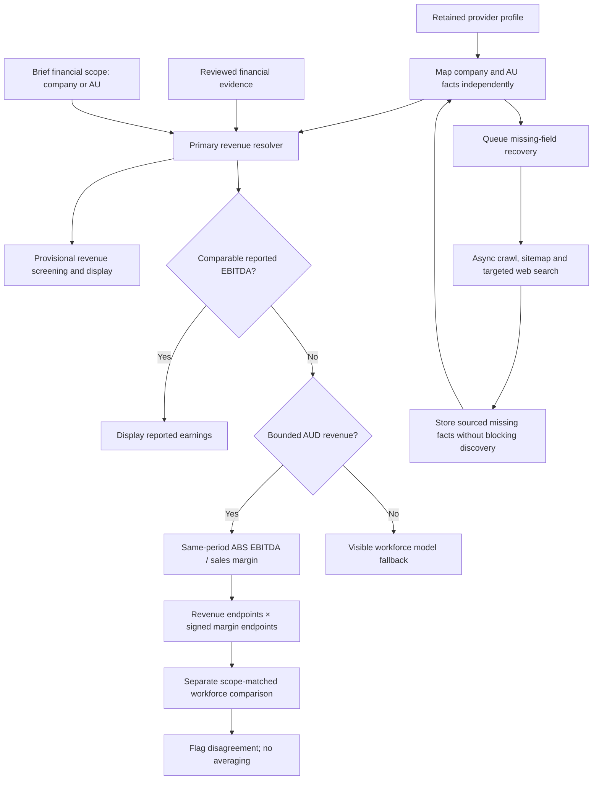

# Primary company revenue and revenue-based EBITDA

Company/group revenue is the default screening figure. An explicit `financialScope: "AU"` brief uses separately scoped Australian revenue; operating geography alone does not change financial scope. The brief editor exposes this choice, and description regeneration preserves it. Company bands remain source evidence, not audited accounts. A currency assumption is independent of a revenue-scope assumption. Missing currency is inferred as AUD only from an Australian provider headquarters; explicit foreign currencies are retained and cannot enter the AUD margin model.

The shared resolver is used by screening, the worksheet, fit review and financial displays. New profiles and legacy JSON are projected without rewriting saved records. Independently reviewed financial values win. Background research still saves a missing AU observation when company revenue is already populated, preserving both observations and their provenance. No database migration or backfill is required; async acquisition remains outside the company discovery completion path.

EBITDA precedence: reported, comparable AUD earnings → reported revenue band × industry EBITDA/sales-and-service-income margin → visible headcount fallback when revenue is unavailable/unusable. Estimated EBITDA does not populate the saved earnings field, increase verified earnings scoring or satisfy finance qualification. Explicit AU briefs reject incompatible company/group earnings. Incompatible scope models are never averaged. Comparable AU workforce scenarios remain separate, and non-overlapping ranges raise a review warning.

ABS observations use numerator and denominator from the same industry population and year. Minimum and maximum signed margins are applied to both revenue endpoints; zero and losses remain possible. Four blank sales cells are explicitly unavailable, not zero; their periods are omitted. Unconfirmed industries use a visible broad fallback requiring review. Industry ratios do not measure variation between individual companies. Source cells, periods, assumptions and calculations remain visible. See [benchmark source contract](../../src/domain/data/abs-ebitda-benchmarks.md).



## TDD and historical verification

Failing tests were run before implementing primary revenue, the margin model, financial display, scope selection/preservation, AU earnings fit/scoring and background AU recovery. Synthetic regressions cover mixed regional coverage, wrapped/legacy profiles, manual precedence, unknown/foreign currency, zero/negative earnings, missing/nonpositive denominators, same-period arithmetic, industry review, scope rejection and independent scenarios. Existing headcount calculations remain unchanged; source contracts preserve the old benchmark observations.

The opt-in [historical integration test](../../src/domain/financial-history.integration.test.ts) opens a repeatable-read **read-only** transaction, asserts every retained company band survives, checks finite ordered model bounds and raw-record preservation, then rolls back. Run with `FINANCIAL_HISTORY_DATABASE_URL` set to a permitted read-only connection, optionally `FINANCIAL_HISTORY_REPORT` for aggregate JSON:

```sh
npx vitest run src/domain/financial-history.integration.test.ts
```

Actual production replay: 359 companies across four saved mandates. Aggregate evidence: [historical replay](verification/financial/historical-replay.json). No personal contacts or raw provider payloads are committed.

| Saved mandate | Companies | Retained primary bands | AUD margin models | Headcount fallback | Unavailable |
|---|---:|---:|---:|---:|---:|
| e7b2cf86 | 100 | 85 | 82 | 3 | 15 |
| fac91964 | 100 | 64 | 0 | 63 | 37 |
| b8e35133 | 67 | 61 | 0 | 58 | 9 |
| a9fb0c38 | 92 | 66 | 0 | 63 | 29 |

Latest-run AU-only revenue remains 23, not 85. Older provider shapes retain company bands but do not establish AUD currency; those cases deliberately preserve the workforce fallback rather than invent a currency. These replay results prove projection and calculation behavior on retained data, not provider data accuracy or future provider availability.

Final verification: 2,076 unit tests passed, 75 environment-gated tests skipped; the historical integration test was run separately and passed against the four production mandates above. TypeScript passed. ESLint passed with the two pre-existing unused-variable warnings. The production Docker build passed. Test receipts are in `verification/financial/`.
